# وثيقة المعمارية الهجينة القائمة على الأهداف (CONV-PLAY-02A Architecture)

**المشروع:** FlowPilot  
**المرحلة:** CONV-PLAY-02A — معمارية المحادثة الموجهة بالأهداف ونموذج الربط الهجين  
**التاريخ:** 19 أكتوبر 2026  
**الهدف:** الانتقال من ترقيعات الكلمات المفتاحية إلى معمارية هجينة قائمة على إسقاط حالة الهدف (Goal-Driven State Projection).

---

## 1. الفلسفة المعمارية ومبادئ التصميم

تهدف هذه المعمارية إلى حل المشكلات الجذرية المحددة في التدقيق (`CONV-PLAY-02A-ROOT-CAUSE.md`) عبر تطبيق المبادئ الصارمة التالية:
1. **عدم إنشاء آلة حالات منافسة (No Second Competing State Machine):**
   - الحفاظ على `ConversationState` الحالي ونموذج الرسائل المعتمد في Prisma دون أي ترحيل لقاعدة البيانات (**Zero Database Migrations**).
   - يتم اشتقاق حالة المهمة عبر **إسقاط نوعي مستمر (Typed Task Projection)** يُستخرج من تاريخ المحادثة التراكمي.
2. **الفصل التام بين الفهم اللغوي وسلطة المعاملات (Separation of Understanding & Execution):**
   - مهمة الذكاء الاصطناعي هي **الفهم الدلالي واستخراج التحديثات (Semantic Extraction)** فقط.
   - التحقق من الأهلية، وجدولة المواعيد، وتحديد التعارضات، وتأكيد الحجز، هي صلاحية حصرية لمحرك الحجز المركزي (`CORE-01` و `CORE-02` و `AppointmentRepository.createWithConflictCheck`).
3. **حل الخيارات بالاستناد إلى آخر عرض مُقدَّم (Unified Option Resolution against Last Offer):**
   - الردود مثل "1" أو "٢" أو "الأول" أو اسم الخدمة/الموعد تُحل حصراً مقابل قائمة الخيارات المعروضة في الجولة السابقة مباشرة، سواء كانت قائمة خدمات أو قائمة فترات مواعيد.
4. **بقاء التفضيلات الصريحة عبر الجولات (Persistence of Stated Preferences):**
   - تفضيلات اليوم والوقت (مثل "بكرة الصبح") تبقى حية وتستمر عبر جولات التوضيح ولا تسقط بمجرد السؤال عن الخدمة.
5. **سلامة العزل والتجريب (Safe Isolated Prototyping):**
   - بناء النموذج الهجين كمنفذ تجريبي (`goal-driven-runner.ts`) خلف مفتاح تجريبي خاص بالمطورين ضمن بيئة الـ Playground دون التعديل الصامت على محرك الإنتاج.

---

## 2. مقارنة المعمارية الحالية مقابل المعمارية المقترحة

```mermaid
flowchart TD
    subgraph Current["المعمارية الحالية (Current Fragile Hybrid B)"]
        C1["رسالة العميل"] --> C2{"تطابق كلمات مفتاحية؟\nbypassDeterministicAi"}
        C2 -- "نعم" --> C3["رد حتمي أو تحويل خاطئ"]
        C2 -- "لا" --> C4["استدعاء LLM أحادي الجولة\n(بدون سياق الأهداف السابقة)"]
        C4 --> C5{"محول الحجز\nbooking-mapper"}
        C5 --> C6["سؤال روبوتي جاف\nأو فقدان الوقت المفضل"]
    end

    subgraph Proposed["المعمارية المقترحة (Goal-Driven Hybrid Prototype)"]
        P1["رسالة العميل"] --> P2["تحميل تاريخ المحادثة الموثوق"]
        P2 --> P3["اشتقاق حالة الهدف الحالية\nGoal-Driven Task Projection"]
        P3 --> P4["تفسير دلالي شامل للجولة\nSemantic Extraction & Intent"]
        P4 --> P5["دمج التحديث في حالة الهدف\nMerge State & Resolve Options"]
        P5 --> P6["التحقق من قواعد العمل وصلاحية الخيارات"]
        P6 --> P7{"ما الإجراء التالي المطلوب؟"}
        P7 -- "نقص معلومة جوهرية" --> P8["سؤال توضيحي ذكي وطبيعي\nمع اقتراح خيارات وتثبيت التفضيلات"]
        P7 -- "المعلومات مكتملة" --> P9["استدعاء CORE-01/02 المعتمدين"]
        P9 --> P10["عرض خيارات متوافقة مع التفضيل\n(صباح/مساء/طبيب)"]
        P7 -- "تأكيد نهائي" --> P11["معاملة حجز آمنة في قاعدة البيانات"]
    end
```



---

## 3. عقد إسقاط حالة الهدف (Goal-Driven Booking Task Projection)

يتم تعريف كائن حالة الهدف بالاعتماد على الأنواع الموجودة في النظام دون تعديل جداول قاعدة البيانات:

```typescript
export type GoalDrivenIntent =
  | "CREATE_APPOINTMENT"
  | "RESCHEDULE_APPOINTMENT"
  | "CANCEL_APPOINTMENT"
  | "ASK_AVAILABILITY"
  | "ASK_CATALOG"
  | "ASK_FAQ"
  | "EXPLICIT_HUMAN"
  | "GENERAL_INQUIRY";

export type OfferedItemType = "SERVICE" | "SLOT" | "PROVIDER" | "CONFIRMATION";

export type OfferedOption = {
  readonly id: string;           // المعرف الداخلي (serviceId أو slot index)
  readonly stableIndex: number;  // الرقم الترتيبي المعروض للعميل (1, 2, 3...)
  readonly title: string;        // النص المعروض
  readonly metadata?: Record<string, unknown>;
};

export type GoalDrivenBookingState = {
  readonly currentGoal: GoalDrivenIntent;
  readonly service: {
    readonly id: string | null;
    readonly name: string | null;
    readonly source: "USER_SELECTED" | "BUSINESS_DEFAULT" | "AUTO_SINGLE" | null;
  };
  readonly provider: {
    readonly id: string | null;
    readonly name: string | null;
    readonly preference: "SPECIFIC" | "ANY" | "SAME_AS_LAST" | null;
  };
  readonly timing: {
    readonly date: string | null;           // YYYY-MM-DD
    readonly dateRange?: { start: string; end: string } | null;
    readonly timePreference: "morning" | "afternoon" | "evening" | null;
    readonly explicitTime: string | null;   // HH:mm
  };
  readonly lastOfferedOptions: {
    readonly type: OfferedItemType;
    readonly items: readonly OfferedOption[];
    readonly offeredAtTurn: number;
  } | null;
  readonly pendingClarification: {
    readonly missingField: "SERVICE" | "DATE" | "TIME" | "PROVIDER" | null;
    readonly promptText: string | null;
  } | null;
  readonly nextRequiredAction:
    | "CLARIFY_SERVICE"
    | "CLARIFY_DATE"
    | "RESOLVE_SLOTS"
    | "AWAIT_CONFIRMATION"
    | "EXECUTE_BOOKING"
    | "ANSWER_AND_RESUME"
    | "HANDOFF_TO_HUMAN";
};
```

---

## 4. قواعد الانتقال وتحديث الحالة (State Transition Rules)

1. **أسبقية قرار العميل الصريح على الافتراضي (Rule 1):**
   - اختيار العميل الصريح للخدمة أو الطبيب يلغي ويفوق الخدمة الافتراضية للعيادة أو خيار "أي طبيب".
2. **استمرارية التفضيلات السابقة عبر الجولات (Rule 2):**
   - إذا صرح العميل بـ "بكرة الصبح"، يتم تسجيل `date` و `timePreference = 'morning'`.
   - إذا احتاج النظام لجولة توضيحية لمعرفة الخدمة، تظل قيمتا التاريخ والفترة الزمنية محفوظة ولا يُعاد السؤال عنهما.
3. **التحديث الموضعي الانتقائي (Rule 3):**
   - المعلومات الجديدة في الجولة الحالية تُحدّث فقط الحقول المعنية دون مسح باقي التفضيلات.
4. **حل الأرقام النسبية مقابل المعروض (Rule 4):**
   - عند استلام "1" أو "٢" أو "الأول":
     - إذا كانت `lastOfferedOptions.type === 'SERVICE'`، يتم فك شفرة الرقم واختيار `serviceId` المقابل للرقم 1.
     - إذا كانت `lastOfferedOptions.type === 'SLOT'`، يتم حجز الموعد المقابل للخيار 1.
     - لا يتم الاعتماد إطلاقاً على ترتيب عشوائي في قاعدة البيانات.
5. **تغيير التاريخ وإعادة حساب المواعيد (Rule 5):**
   - إذا غيّر العميل التاريخ بعد اختيار الخدمة، يُحفظ التاريخ الجديد وتُلغى عروض الأوقات السابقة ويُعاد فحص المتاح لليوم الجديد فوراً.
6. **تغيير الخدمة وإلغاء اختيارات الطبيب غير المتوافقة (Rule 6):**
   - إذا غيّر العميل الخدمة، يتم فحص أهلية الطبيب المختار سابقاً للخدمة الجديدة؛ فإذا لم يكن مؤهلاً، يُلغى تفضيل الطبيب ويُسأل العميل مجدداً.
7. **منع تحويل الأسئلة العادية إلى حجز (Rule 7):**
   - إذا سأل العميل في المنتصف سؤالاً عاماً (مثل مواعيد العمل أو موقع العيادة)، يُجاب السؤال من قاعدة المعرفة أولاً، ثم يُعرض عليه استئناف الحجز القائم دون فقدان اختياراته (`answer-and-continue`).

---

## 5. معالجة حالات الخدمة الافتراضية (Default Service Decision Matrix)

| الحالة | الشروط | السلوك المعتمد |
|---|---|---|
| **الحالة A: الحجز السريع بالخدمة الافتراضية** | تفعيل الإعداد + وجود خدمة صالحة ونشطة ومؤهلة | تُختار الخدمة الافتراضية تلقائياً دون سؤال العميل، وتُعرض المواعيد المتاحة مباشرة مع الاحتفاظ بأي تفضيل زمني قُدِّم في نفس الرسالة. |
| **الحالة B: منشأة بها خدمة واحدة فقط** | وجود خدمة نشطة وحيدة | تُعتمد الخدمة تلقائياً وتُعرض المواعيد فوراً دون سؤال زائد. |
| **الحالة C: خدمات متعددة وبدون خدمة افتراضية** | أكثر من خدمة نشطة وبدون افتراضي مفعل | تُعرض قائمة مرقمة واضحة وموجزة بالخدمات المتاحة مع دعم الأزرار، ويتم ربط رد العميل اللاحق بتلك القائمة حصراً. |
| **الحالة D: خدمة افتراضية غير صالحة أو محذوفة** | المعرف المخزن غير نشط أو محذوف | الرجوع التلقائي الصادق إلى الحالة C (عرض الخدمات الفعلية) دون اختراع أو تعطل. |
| **الحالة E: استفسار طارئ أو خطير** | احتواء الرسالة على كلمات طارئة أو حرجة | أسبقية الأمان والتحويل البشري الفوري؛ لا يُطبق الحجز السريع أبداً على الحالات الحساسة. |

---

## 6. تقييم المخاطر والبدائل والقرارات البديلة

| الخيار المعماري | المزايا | المخاطر | القرار والتعليل |
|---|---|---|---|
| **1. إضافة جداول Prisma جديدة لحفظ حالة المهمة** | حفظ دائم في قاعدة البيانات | يتطلب تعديل المخطط وتشغيل ترحيلات إنتاجية معقدة ومخاطر تزامن. | **مرفوض:** تم استبعاده التزاماً بتوجيهات DEVOPS-01E (Zero Migrations)، واشتقاق الحالة من سجل الرسائل الموثوق كافٍ تماماً. |
| **2. الاستمرار في ترقيع الكلمات المفتاحية (Regex Hotfixes)** | لا يتطلب كتابة كود كثير | تضارب لا نهائي، هشاشة لغوية، وفشل متكرر مع اللهجات واللغة الطبيعية. | **مرفوض قطعاً:** ثبت فشله مخبرياً في `CONV-PLAY-02A-ROOT-CAUSE.md`. |
| **3. المعمارية الهجينة الموجهة بالأهداف (المعتمدة)** | حل جذري للأرقام والتفضيلات، مرونة لغوية، وضوح القرار، صفر ترحيلات قاعدة بيانات. | تتطلب اختبارات تدقيقية دقيقة ومنفذاً تجريبياً معزولاً. | **مُعتمد:** يوفر حلاً آمناً وقابلاً للقياس والتحقق. |
