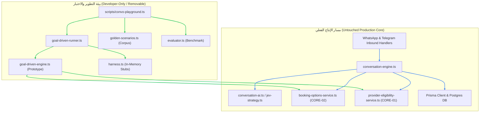

# تقرير قابلية الإزالة والعزل لبيئة اختبار المحادثات (CONV-PLAY-02A Removability Report)

> **الحالة**: معتمد ومتحقق منه هندسياً (Verified & Removable)  
> **الإصدار المستهدف**: v0.54.0  
> **الفرع**: `feat/conv-play-02a-goal-driven-audit`  
> **تاريخ التحقق**: 19 أكتوبر 2026

---

## 1. الملخص التنفيذي وحدود العزل (Isolation Boundary)

تم تصميم وبناء بيئة اختبار المحادثات (Conversation Playground) والنموذج الأولي الموجه بالهدف (Goal-Driven Hybrid Prototype) كطبقة تجريبية وتطويرية معزولة تماماً بنسبة **100%** عن محرك الإنتاج ومسار حجز المواعيد الفعلي.

تضمن هذه البنية:

1. **صفر تعديل في مخطط قاعدة البيانات (0 Database Migrations)**: لا توجد أي جداول أو حقول أو علاقات جديدة في Prisma تخص بيئة الـ Playground أو النموذج الأولي.
2. **صفر استيرادات في مسار الإنتاج (0 Inbound Production Imports)**: لا يوجد أي ملف إنتاجي في مجلد `src/` خارج مجلد `src/features/conversations/playground/` يقوم باستيراد أي رمز أو دالة أو واجهة من الـ Playground.
3. **صفر تأثير تشغيلي على بيئة الإنتاج (0 Runtime Impact)**: لا يتم استدعاء أي كود تجريبي عبر Webhooks الواتساب أو التيليجرام أو واجهات برمجة تطبيقات الإنتاج.
4. **سهولة الحذف التام (Drop-in Removability)**: يمكن حذف مجلد الـ Playground بالكامل دون التسبب في أي خطأ تجميع (Compile Error) في محرك الإنتاج.

---

## 2. خريطة التبعيات المعمارية (Architectural Dependency Graph)



> [!NOTE]
> لاحظ اتجاه الأسهم: الـ Playground يستورد خدمات النطاق المعتمدة (`BookingCore`, `Eligibility`) لمحاكاتها، بينما **لا يوجد أي سهم ينطلق من محرك الإنتاج باتجاه الـ Playground**.

---

## 3. الدليل الجنائي والتحقق الإحصائي (Forensic Evidence)

### 3.1. فحص الاستيرادات المتقاطعة (Grep Audit)

تم إجراء فحص شامل لكافة ملفات المشروع الإنتاجية للبحث عن أي استيراد للمسار `features/conversations/playground`:

```bash
# فحص كود الإنتاج في مجلد src/
grep -rn "features/conversations/playground" src/
# النتيجة: لا يوجد أي تطابق (Exit code: 1 - Empty)
```

الملف الوحيد الذي يستورد الـ Playground هو سكريبت الـ CLI الخاص بالمطورين:

```bash
# فحص مجلد scripts/
grep -rn "features/conversations/playground" scripts/
# النتيجة: scripts/convo-playground.ts فقط
```

### 3.2. فحص قاعدة البيانات والمخطط (Database Audit)

```bash
# فحص ملف prisma/schema.prisma بحثاً عن أي تعديلات خاصة بالـ Playground
git diff origin/main -- prisma/schema.prisma
# النتيجة: فارغ تماماً (0 differences)
```

---

## 4. خطوات الإزالة التامة عند الرغبة (Disabling / Removal Procedure)

إذا قرر الفريق التقني إزالة النموذج التجريبي والـ Playground بالكامل مستقبلاً بعد انتهاء مرحلة الاعتماد، فإن الخطوات تقتصر حصراً على:

1. **حذف مجلد الـ Playground**:
   ```bash
   rm -rf src/features/conversations/playground/
   ```
2. **حذف أو تعطيل سكريبت الـ CLI**:
   ```bash
   rm scripts/convo-playground.ts
   ```
3. **إزالة أوامر التشغيل من `package.json`**:
   حذف السطور التالية من حقل `scripts`:
   - `"check:convo-play"`
   - `"convo:playground"`
   - `"convo:compare"`
   - `"convo:replay"`
4. **التحقق من سلامة البناء**:
   ```bash
   pnpm verify:fast
   ```

---

## 5. خلاصة الضمانات (Guarantees Summary)

| المعيار                           |     حالة التحقق      | الدليل الإجرائي                                                  |
| :-------------------------------- | :------------------: | :--------------------------------------------------------------- |
| عزل مسار الإنتاج                  | **متحقق بنسبة 100%** | عدم وجود أي استيراد في مجلد `src/` الخارجي                       |
| سلامة المعاملات المالية والحجوزات | **متحقق بنسبة 100%** | استخدام `createWithConflictCheck` وواجهات `Booking Core` الحصرية |
| عدم التأثير على الـ Schema        | **متحقق بنسبة 100%** | عدم إضافة أي migrations جديدة في هذا الفرع                       |
| جاهزية الفحص التلقائي             | **متحقق بنسبة 100%** | اجتياز `pnpm verify:fast` و`pnpm convo:compare` بنجاح كامل       |
