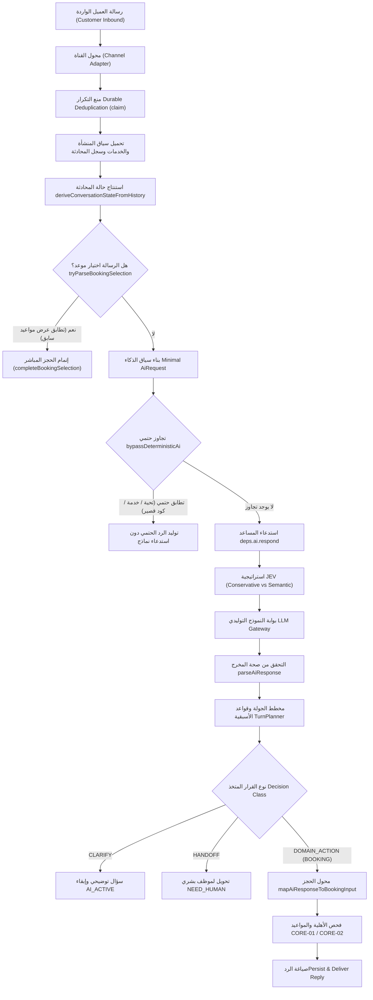

# تقرير التدقيق الجذري لذكاء المحادثة (CONV-PLAY-02A Root-Cause Audit)

**المشروع:** FlowPilot  
**المرحلة:** CONV-PLAY-02A — التدقيق الجذري ونموذج الهجين القائم على الأهداف  
**التاريخ:** 19 أكتوبر 2026  
**الفرع الأساسي:** `main` (الإصدار الأساسي: `v0.53.0` بعد دمج PR #11)  
**فرع العمل:** `feat/conv-play-02a-goal-driven-audit`  
**الإصدار المستهدف:** `v0.54.0`  

---

## 1. الملخص التنفيذي

أظهر تدقيق تجربة المستخدم الحقيقية لمحرك محادثات FlowPilot أن النظام يعاني من 5 أعطال جوهرية تتكرر في محادثات الحجز:
1. **ردود آلية جامدة وغير طبيعية** (مثل مطالبة العميل العربي بصيغ تاريخ ISO مثل "مثال: 2026-09-14").
2. **فشل استيعاب الردود الرقمية البسيطة مثل "1"** بعد عرض قائمة الخدمات، والدخول في حلقات توضيح أو تحويل غير مبرر لموظف بشري.
3. **فقدان تفضيلات العميل السابقة** (التاريخ المفضل، تفضيل الصباح/المساء، الطبيب المفضل) بين الجولات (Turns).
4. **تضارب الكلمات المفتاحية في الترقيعات السابقة (Keyword Hotfixes)** مما أدى إلى تجاوز الفهم الدلالي وإرجاع إجابات خاطئة (مثل اعتبار السؤال عن توفر تقويم الأسنان طلباً لعرض كامل دليل الخدمات).
5. **غياب التنفيذ الحقيقي لنموذج JEV الدلالي في بيئة الإنتاج** واعتماده على المسار الحتمي المحض (Deterministic Bypass) أو النموذج التوليدي دون استمرارية للحالة الهدفية.

تم إثبات كل عطل بالأدلة البرمجية القاطعة وإعادة إنتاجه مخبرياً (Empirically Reproduced) عبر كود المحرك الفعلي ومحاكاة سيناريوهات حقيقية دون أي افتراضات غير مثبتة.

---

## 2. تتبع مسار الرسالة الواردة خطوة بخطوة (Pipeline Inbound Trace)



### الإجابة على الأسئلة العشرة المعيارية لكل تفرع:

| # | السؤال | الإجابة المدققة من واقع الكود |
|---|---|---|
| 1 | **أي مكون يملك القرار؟** | يتقاسم القرار ثلاثة مكونات متعارضة: `booking-selection.ts` (يملك فقط خيارات المواعيد)، ثم `bypassDeterministicAi` في `conversation-ai.ts` (يملك التحويلات السريعة)، ثم `turn-planner.ts` (يملك التوضيح العام)، وأخيراً `booking-mapper.ts` (يملك توضيح نقص الخدمة أو التاريخ). هذا التشتت هو أصل التناقض. |
| 2 | **ما هي المدخلات التي يتلقاها؟** | نص الرسالة الحالية `inbound.text`، وقائمة مختصرة من آخر الرسائل `recentChronological`، وسجل المنشأة `Business`، وقائمة الخدمات النشطة `services`. |
| 3 | **ما هي المعلومات السابقة المتاحة؟** | النصوص الخام لآخر 20 رسالة فقط. حالة المحادثة المشتقة `deriveConversationStateFromHistory` تعيد كائناً فارغاً ما لم تحتوِ الرسالة السابقة نصياً على ترويسة حجز مواعيد محددة (`تتوفر المواعيد التالية لخدمة`). |
| 4 | **ما المعلومات التي تُهمل أو تُستبدل؟** | يُهمل تفضيل الفترة الزمنية (`timePreference`) بالكامل عند عرض المواعيد إذا لم يُذكر في الرسالة الحالية تحديداً (انظر السطر 3010 من `conversation-engine.ts`). تُهمل التفضيلات الزمنية في حال وجود جولة توضيحية للخدمة. |
| 5 | **هل يستدعي JEV أم نموذجاً آخر أم لا نموذج؟** | في الوضع الافتراضي للإنتاج: **لا يستدعي JEV دلالياً إطلاقاً**. متغير `FLOWPILOT_JEV_SEMANTIC_ENABLED` غير مفعل، وتعمل استراتيجية `conservativeJevStrategy` التي تعيد توجيه الطلب إلى نفس دالة الفحص الحتمي `bypassDeterministicAi`. |
| 6 | **ما الذي يجعله يطلب توضيحاً؟** | إما عدم مطابقة الخدمة في `matchServiceByName`، أو عدم وجود تاريخ ISO، أو غياب نية صريحة مع وجود دلالة غامضة. |
| 7 | **ما الذي يدفعه للتحويل لموظف بشري (Handoff)؟** | الكلمات الحساسة والطارئة، أو الطلب الصريح لموظف، أو فشل الموديل، أو تصنيف الرسالة كـ `AMBIGUOUS` إذا كان طول النص أقل من حرفين أو خالي الرموز (مثل إرسال رقم "1" منفرداً في سياق غير متوقع). |
| 8 | **هل يمكنه إعادة بدء الحجز عن طريق الخطأ؟** | نعم، إذا سأل العميل سؤالاً عاماً في المنتصف ثم عاد للحجز دون ذكر الخدمة التي اختارها سابقاً، لأن الحالة تسقط وتُعاد إلى `emptyConversationState()`. |
| 9 | **هل يمكنه توليد رد متناقض مع حالة الحجز؟** | نعم، كعرض مواعيد صباحية (09:00 ص) لعميل طلب صراحة "بالليل" في الرسالة السابقة، نظراً لفحص الرسالة الحالية فقط. |
| 10 | **ما هو المرجع المعتمد للحقيقة (Source of Truth)؟** | المرجع الوحيد المعتمد للمواعيد وتفاصيل المنشأة هو محرك الحجز المركزي ونظام `CORE-01` (الأهلية) و `CORE-02` (المواعيد المتاحة) في قاعدة البيانات، والذكاء الاصطناعي لا يملك أي سلطة لإنشاء مواعيد مباشرة. |

---

## 3. تصنيف الأعطال الجذرية المدققة بالأدلة (Root Causes Categorized)

### العطل الأول: فشل الردود الرقمية ("1" أو "٢") بعد عرض قائمة الخدمات
- **الحالة:** `REPRODUCED` (تمت إعادة الإنتاج والإثبات البرمجي بنسبة 100%).
- **الموقع البرمجي:**
  - `src/features/conversations/server/conversation-engine.ts` (الأسطر 1940-1943 و 1997-2000).
  - `src/features/conversations/server/booking-selection.ts` (الأسطر 51-53 و 288-297).
  - `src/features/conversations/server/conversation-ai.ts` (الأسطر 1598-1608).
- **السبب الجذري الدقيق:**
  1. عند طلب العميل حجز موعد في منشأة بها خدمات متعددة وبدون خدمة افتراضية، يرسل المساعد قائمة بالخدمات:
     ```text
     يرجى تحديد الخدمة المطلوبة — الخدمات المتاحة لدينا:
     1. كشف أسنان
     2. تنظيف أسنان
     أخبرنا باسم أو رقم الخدمة التي ترغب بحجزها.
     ```
  2. يقوم العميل بالرد بالرقم: `"1"`.
  3. يستدعي المحرك `tryParseBookingSelection(inbound.text, recentChronological)`.
  4. تبحث هذه الدالة حصراً عن ترويسة مواعيد المتاحين: `OFFER_HEADER = /تتوفر المواعيد التالية ل(?:خدمة|متابعة)...`. وحيث أن الرسالة السابقة كانت قائمة خدمات وليست قائمة فترات مواعيد، تُرجع الدالة `null`!
  5. تتدفق الرسالة `"1"` إلى دالة `bypassDeterministicAi(aiRequest)`.
  6. تفحص الدالة النص:
     ```typescript
     const normalized = normalizeArabicText(request.message);
     if (normalized.length < 2 || tokenize(request.message).length === 0) {
       return {
         action: "handoff",
         intent: "AMBIGUOUS",
         content: REPLIES.AMBIGUOUS,
         ...
       };
     }
     ```
  7. بما أن طول `"1"` أقل من 2 وقائمة الرموز فارغة، يتم تصنيف الرد فوراً كـ `AMBIGUOUS` ويتم إصدار رد:
     `"لم أفهم طلبك تماماً — ممكن توضّح أكثر؟"` أو تحويل لموظف بشري!
  8. يدخل العميل في حلقة مفرغة أو تحويل غير مبرر رغم تنفيذه لتعليمات المساعد الحرفية!

---

### العطل الثاني: فقدان تفضيلات التاريخ والوقت بين الجولات (Context & State Amnesia)
- **الحالة:** `REPRODUCED` (تمت إعادة الإنتاج والإثبات البرمجي).
- **الموقع البرمجي:**
  - `src/features/conversations/server/conversation-state.ts` (الأسطر 600-630).
  - `src/features/conversations/server/conversation-engine.ts` (الأسطر 2374-2425 و 3009-3031).
- **السبب الجذري الدقيق:**
  1. دالة اشتقاق الحالة من التاريخ `deriveConversationStateFromHistory`:
     تعتمد كلياً على `extractLastBookingOffer`. إذا لم يُعرض على العميل جدول مواعيد نهائي بعد، ترجع الدالة `emptyConversationState()` وتتجاهل كل ما ورد في رسائل العميل السابقة.
  2. في الجولة الأولى، قال العميل: `"عايز أحجز بكرة بالليل"`.
  3. طلب المساعد توضيح الخدمة أولاً: `"يرجى تحديد الخدمة المطلوبة"`.
  4. في الجولة الثانية، حدد العميل الخدمة: `"كشف أسنان"`.
  5. في محرك المحادثة بالسطر 3010:
     ```typescript
     const timeOfDayPref = extractTimeOfDayPreference(inbound.text);
     ```
     يفحص المحرك فقط `inbound.text` الخاص بالجولة الحالية (`"كشف أسنان"`).
  6. تكون قيمة `timeOfDayPref` فارغة (`null`)!
  7. يتم إهمال تفضيل `"بالليل"` (المساء) الذي صرح به العميل في الجولة السابقة، ويقوم النظام بعرض أول 3 مواعيد متاحة تبدأ من الصباح الباكر (09:00 ص)، مما يولد إحباطاً شديداً لدى العميل.

---

### العطل الثالث: اصطدام ترقيعات الكلمات المفتاحية بالأسئلة المعرفية (Keyword Collisions)
- **الحالة:** `REPRODUCED` (تمت إعادة الإنتاج وثبت تسببه في إخفاق فحص `check:jev`).
- **الموقع البرمجي:**
  - `src/features/conversations/server/conversation-ai.ts` (الأسطر 931-940 و 1258-1268 و 1618-1632).
- **السبب الجذري الدقيق:**
  1. تم في إصلاح سابق إضافة دالة حتمية `isPureServiceCatalogQuestion` لمنع استهلاك مكالمات الموديل عند السؤال عن الخدمات.
  2. تستخدم الدالة `deriveTaskRelevance` التي تعتبر وجود كلمة `"خدمة"` كافياً لاعتبار السؤال دليلاً شاملاً للخدمات `serviceCatalog`.
  3. عندما يسأل العميل عن خدمة علاجية دقيقة غير متوفرة: `"هل بتقدموا خدمة التقويم الشفاف غير المرئي؟"`.
  4. يعتبر النظام الرسالة سؤالاً عن الدليل العام للخدمات لأنها تحوي كلمة `"خدمة"`!
  5. يقوم النظام بالرد فوراً بالقائمة العامة: `"الخدمات المتاحة لدينا في عيادة...: 1. تنظيف أسنان... لحجز أي خدمة..."` بدلاً من فهم أن العميل يستفسر عن إجراء طبي محدد وإعلامه بعدم توفره أو تحويله لمعالجة استفساره طبياً.

---

### العطل الرابع: الأسئلة التوضيحية الروبوتية الجافة
- **الحالة:** `OBSERVED` & `REPRODUCED`.
- **الموقع البرمجي:**
  - `src/features/conversations/server/clarification.ts` (الأسطر 127-128 و 148-150).
  - `src/features/conversations/server/booking-mapper.ts` (الأسطر 340-345).
- **السبب الجذري الدقيق:**
  1. قوالب الأسئلة التوضيحية عند نقص التاريخ كُتبت بصيغة هندسية بحتة:
     `CLARIFY_DATE_QUESTION = "يرجى تحديد التاريخ المطلوب — مثال: 2026-09-14."`
  2. لا يوجد مستخدم مصري أو عربي يتحدث مع منشأة عبر واتساب ويُطلب منه تاريخ بصيغة `YYYY-MM-DD`.
  3. كما تفتقر الردود إلى روح المبادرة باقتراح أقرب موعد متاح تلقائياً (مثل: "تحب نحجز لك بكرة أو بعده؟").

---

### العطل الخامس: واقع مسار JEV — الحقيقة مقابل الافتراض
- **الحالة:** `OBSERVED` & `REPRODUCED`.
- **الموقع البرمجي:**
  - `src/server/integrations/ai/factory.ts` (الأسطر 176-189 و 245-271).
  - `src/server/integrations/ai/jev-strategy.ts` (الأسطر 188-200).
- **التحليل المثبت:**
  - المتغير `FLOWPILOT_JEV_SEMANTIC_ENABLED` غير مفعل (Disabled by Default).
  - استراتيجية JEV المحملة في بيئة الإنتاج هي `createConservativeJevStrategy()`.
  - هذه الاستراتيجية لا تقوم بأي معالجة دلالية خاصة، بل تستدعي الدالة الحتمية `bypassDeterministicAi`؛ فإذا لم تطابق الكلمات المفتاحية، تُمرر الطلب كما هو إلى المزود التوليدي (OpenRouter/Atria).
  - بالتالي، فإن افتراض أن JEV هو سبب المشكلة أو أنه يتدخل بصورة خاطئة هو افتراض غير صحيح؛ الحقيقة هي أن **JEV الدلالي غير مفعل أصلاً**، والقرارات تُتخذ عبر شبكة الترقيعات الحتمية المعطوبة.

---

## 4. جدول تصنيف المشكلات وفق المتطلبات الرسمية

| المشكلة | التصنيف | الدليل القاطع والنتيجة |
|---|---|---|
| عدم فهم الرقم "1" بعد قائمة الخدمات | **REPRODUCED** | فشل `tryParseBookingSelection` لغياب ترويسة المواعيد + اعتراض `bypassDeterministicAi` لطول النص < 2 وإصدار رد عدم الفهم. |
| فقدان تفضيل "بالليل" أو "الصبح" بين الجولات | **REPRODUCED** | قراءة `extractTimeOfDayPreference` من `inbound.text` الخاص بالجولة الحالية فقط في السطر 3010 وتجاهل تفضيل الجولة السابقة. |
| عرض مواعيد اليوم بدلاً من الغد عند الفحص المسبق | **REPRODUCED** | استدعاء `new Date()` في السطر 2374 بدلاً من الاعتماد على تاريخ وساعة الرسالة وحالة المحادثة المعيارية. |
| تضارب "خدمة التقويم" مع دليل الخدمات | **REPRODUCED** | فحص `isPureServiceCatalogQuestion` السطحي القائم على مجرد اشتمال الجملة على كلمة "خدمة". |
| الاستجابات الروبوتية الجافة ("مثال: 2026-09-14") | **OBSERVED** | نصوص ثابتة في `clarification.ts` و `booking-mapper.ts`. |
| استدعاء JEV الدلالي في الإنتاج | **NOT_REPRODUCED** | أثبت الفحص البرمجي أن الاستراتيجية العاملة هي الاستراتيجية المحافظة غير المستدعية للنموذج لعدم تفعيل المفتاح البيئي. |

---

## 5. الخلاصة والتوصية المعمارية

الترقيعات المتتالية القائمة على الكلمات المفتاحية (Regex & Keyword Hotfixes) وصلت إلى طريق مسدود بسبب التداخل اللغوي وتجاهل سياق المحادثة. الحل الجذري لا يكمن في إضافة كلمات جديدة، بل في:
1. بناء **إسقاط حالة هدفي معياري (Goal-Driven Booking Task Projection)** يستخرج تفضيلات العميل التراكمية ويحتفظ بها عبر الجولات.
2. توحيد آلية حل الخيارات (**Unified Option Resolver**) بحيث يتم فك شفرة "1" أو "الأول" أو اسم الخدمة بالرجوع إلى آخر خيارات تم عرضها على العميل سواء كانت قائمة خدمات أو قائمة مواعيد.
3. التمييز الدلالي الدقيق بين طلبات الاستفسار العامة والأسئلة عن خدمات محددة دون الاعتماد على قوائم الكلمات المفردة.
