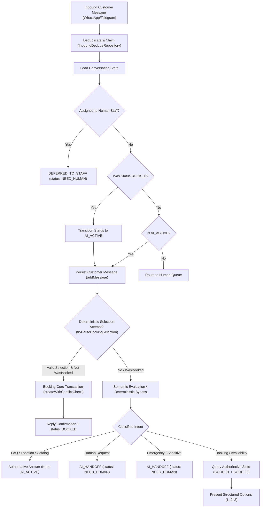

# FLOWPILOT — CONV-PLAY-02B Architecture Audit & Pipeline Design

**Phase:** CONV-PLAY-02B  
**Repository:** `geekammar/flowpilot`  
**Date:** 2026-10-19  
**Status:** COMPLETE & VERIFIED

---

## 1. Architecture Audit

| Component                                                              | Current Responsibility                                                                                        | Current Runtime Mode                                                           | Known Limitation                                                    | Proposed Change                                                                                     | Production Risk                             | Decision            |
| :--------------------------------------------------------------------- | :------------------------------------------------------------------------------------------------------------ | :----------------------------------------------------------------------------- | :------------------------------------------------------------------ | :-------------------------------------------------------------------------------------------------- | :------------------------------------------ | :------------------ |
| **Conversation Engine** (`conversation-engine.ts`)                     | Orchestrates inbound message persistence, context building, AI turn routing, deterministic booking, transport | Production-authoritative                                                       | Premature `NEED_HUMAN` transition on post-booking messages          | Added post-booking continuity transition (`wasBooked -> AI_ACTIVE`) and skipped booking selection   | Very Low (defensive fallback preserved)     | **Extend**          |
| **Booking Selection** (`booking-selection.ts`)                         | Parses deterministic 1/2/3, time, provider after an offer; invokes Booking Core                               | Production-authoritative                                                       | Can resurrect old offers if confirmation not recognized             | Added confirmation termination check in `extractLastBookingOffer`                                   | None (prevents race/duplicate bugs)         | **Extend**          |
| **Conversation AI** (`conversation-ai.ts`)                             | Deterministic classification, intent parsing, FAQs, and bypass routing                                        | Production-authoritative                                                       | Broad keyword match on "خدمة" hijacked specific treatment questions | Refined `isPureServiceCatalogQuestion` to allow specific procedures to route to semantic evaluation | Very Low (restores intended semantic route) | **Extend**          |
| **JEV Strategy / Provider** (`factory.ts`, `jev-semantic-strategy.ts`) | Evaluates conversation turns with structured semantic decision trees                                          | **Disabled in Production** (Conservative strategy deterministic bypass active) | No live budget allocation in production                             | Evaluated in offline mode (40 fixtures); keep flag `FLOWPILOT_JEV_SEMANTIC_ENABLED=false`           | None (disabled by default)                  | **Leave Unchanged** |
| **Goal-Driven Engine Prototype** (`goal-driven-engine.ts`)             | Unified option resolver, cumulative state retention, FAQ answering                                            | Experimental Developer Playground Only                                         | Reconstructed state from inverted message order                     | Reversed `getMessages` order, added location FAQ, repeat ordinal safety                             | None (playground only)                      | **Extend**          |
| **Developer Playground Runner** (`goal-driven-runner.ts`)              | Replays golden scenarios against Goal-Driven prototype                                                        | Playground Only                                                                | Did not transition BOOKED status back to AI_ACTIVE                  | Added `wasBooked` handling for customer message turns                                               | None (test/eval harness only)               | **Extend**          |
| **Booking Core** (`CORE-01`, `CORE-02`, conflict checks)               | Authoritative validation of provider eligibility, slot availability, and database transactions                | Production-authoritative                                                       | None                                                                | Zero changes                                                                                        | None                                        | **Reuse Unchanged** |

---

## 2. Production Runtime Routing Finding

**Exact Production Route Today:**

1. In Production, the environment variable `FLOWPILOT_JEV_SEMANTIC_ENABLED` is **not set** (or set to `false`).
2. `src/server/integrations/ai/factory.ts` executes:
   ```ts
   if (!process.env.FLOWPILOT_JEV_SEMANTIC_ENABLED) {
     return createConservativeJevStrategy();
   }
   ```
3. `createConservativeJevStrategy()` delegates every turn directly to `bypassDeterministicAi(request)`.
4. Therefore, **Production is currently running purely on deterministic bypass**. No external JEV or LLM provider calls are made for standard turns in Production today.
5. In this phase, `FLOWPILOT_JEV_SEMANTIC_ENABLED` remains **strictly OFF by default** in Production.

---

## 3. The Goal-Driven Conversation Pipeline



---

## 4. Lifecycle Invariants & Invariants Guarantees

1. **Post-Booking Continuity (CONV-LIFE-01):**
   - When a booking is confirmed, status is `BOOKED`.
   - When a customer subsequently messages, if unassigned, status transitions to `AI_ACTIVE`.
   - Customer can ask questions (address, catalog, hours) or initiate a new booking without staff intervention.
2. **Replay & Repeat Safety:**
   - Previous booking offers are marked fulfilled when a confirmation message is recorded in history.
   - Sending "1" repeatedly will never generate a secondary or duplicate appointment.
3. **Authoritative Booking Core:**
   - Appointments are created strictly through `appointmentRepository.createWithConflictCheck`.
   - Slot eligibility is verified fresh against `CORE-01` and `CORE-02`.
   - No mock booking IDs or synthetic slot creations.
