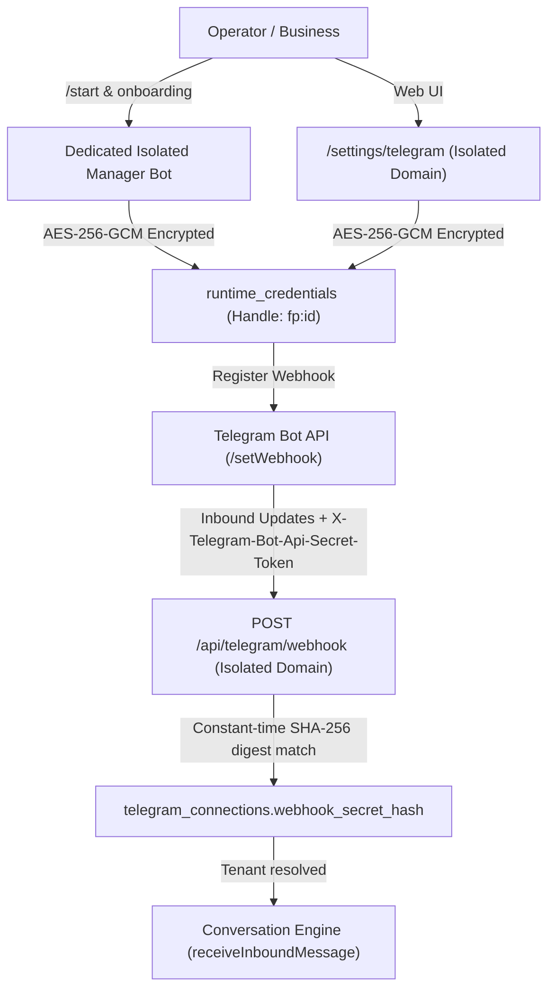

# FlowPilot — Post-Merge Telegram Acceptance Readiness & Operator Runbook

> **Authoritative Acceptance Readiness Record & Operator Runbook**  
> Covers baseline lineage verification, offline acceptance matrix results, concrete execution limit classifications, and the executable live acceptance plan for Telegram bot integration.

---

## 1. Baseline and Deployment Verification

| Check / Dimension               | Expected Fact / Standard                                 | Observed Reality                                                                              | Verification Source / Command                                            | Status           |
| :------------------------------ | :------------------------------------------------------- | :-------------------------------------------------------------------------------------------- | :----------------------------------------------------------------------- | :--------------- |
| **Merged Baseline PR**          | PR #29 (`feat/core-04b-global-ai-stop-execution-limits`) | PR #29 merged to `main` at `d291f1ac7cd22c7b8ac80cc05a6a39be97df53c4`                         | `git show origin/main -s`                                                | ✅ MATCH         |
| **Baseline Package Version**    | `0.70.0` (PR #29 baseline)                               | `0.70.0` (PR #29 baseline); incremented to `0.70.1` on feature branch for PR #30 quality gate | `git show origin/main:package.json`, `pnpm check:version`                | ✅ VERIFIED      |
| **Current origin/main SHA**     | `d291f1ac7cd22c7b8ac80cc05a6a39be97df53c4`               | `d291f1ac7cd22c7b8ac80cc05a6a39be97df53c4` (tag `v0.70.0`)                                    | `git rev-parse origin/main`                                              | ✅ UP-TO-DATE    |
| **Current Feature Branch HEAD** | PR #30 (`feat/telegram-acceptance-readiness`)            | Tracked on `origin/feat/telegram-acceptance-readiness`                                        | `git rev-parse HEAD`                                                     | ✅ CURRENT       |
| **Production Health URL**       | `https://flowpilot-prod.vercel.app/api/health`           | HTTP 200 OK                                                                                   | `curl -sS https://flowpilot-prod.vercel.app/api/health`                  | ✅ HEALTHY       |
| **Deployed Production SHA**     | `d291f1ac7cd22c7b8ac80cc05a6a39be97df53c4`               | `d291f1ac7cd22c7b8ac80cc05a6a39be97df53c4`                                                    | `/api/health` `commitSha`                                                | ✅ DEPLOYED_HEAD |
| **Deployed Production Version** | `0.70.0`                                                 | `0.70.0`                                                                                      | `/api/health` `version`                                                  | ✅ MATCH         |
| **Production DB State**         | `connected`, `deploymentReady: true`                     | `database: "connected"`, `deploymentReady: true`, `missingEnvVars: []`                        | `/api/health` response body                                              | ✅ CONNECTED     |
| **Production Health Timestamp** | Read-only observation                                    | `2026-10-23T18:37:11.639Z`                                                                    | Live response payload                                                    | ✅ RECORDED      |
| **Production CI Status**        | Post-deploy workflow passed                              | Success (Run `40000933519`)                                                                   | `gh run list --workflow "Production Release & Post-Deploy Verification"` | ✅ PASSED        |
| **Environment Isolation**       | Isolated staging/test environment                        | **PRODUCTION SHARED NEON POSTGRES** (`flowpilot-prod.vercel.app` is production; not isolated) | `docs/BUILD_STATE.md`, `/api/health` `environment: "production"`         | ⚠️ PROD_SHARED   |

> [!IMPORTANT]
> **Lineage Verdict: DEPLOYMENT_VERIFIED_CURRENT.**  
> The deployed production application at `flowpilot-prod.vercel.app` matches `origin/main` commit `d291f1a` (v0.70.0).  
> **However, `flowpilot-prod` is the LIVE production environment sharing the production Neon database and production credentials.** Live acceptance testing against production resources is strictly unauthorized and blocked until an isolated test environment is provisioned or operator authorization is granted under the live runbook below.

---

## 2. Acceptance Evidence Levels

All test cases and execution stages are classified strictly by the following four levels. Higher levels must **never** be inferred from lower levels:

- **Level A: Offline Controlled-Provider Execution.**  
  Injected mock/controlled AI adapters, in-memory state repository (`InMemoryConversationStateStore` with CAS revision tracking), in-memory appointments, deterministic availability, zero network wire calls, zero external provider spend.
- **Level B: Real-Provider Execution with Isolated In-Memory Repositories.**  
  Real LLM/JEV API HTTP calls via provider adapters under an authorized spend envelope, but strictly bounded to in-memory repositories and mock channel transports (zero database mutations, zero outbound messages).
- **Level C: Isolated Persistent-Database Integration.**  
  Dedicated, isolated staging/test PostgreSQL database running real Prisma repositories and migrations, separate from production data.
- **Level D: Actual Telegram Webhook-to-Reply Execution.**  
  End-to-end execution from incoming Telegram update through route proxy, webhook HMAC digest verification, Conversation Engine, Booking Core, database persistence, and outbound `sendMessage` to the Telegram Bot API.

---

## 3. Acceptance Matrix: 16 Journeys Verified Offline (Level A)

### Fixed Synthetic Business Configuration:

- **Business Name:** `عيادة النور لطب الأسنان`
- **Timezone:** `Africa/Cairo` (UTC+3 in late October under Egypt DST; UTC+2 standard time)
- **Reference Instant:** `2026-10-22T10:00:00.000Z` = **Thursday 13:00 (1:00 PM) Cairo time (UTC+3)**
- **Catalog Services:**
  1. `33333333-3333-4333-8333-333333333331`: "كشف أسنان" (30 min, 150 EGP)
  2. `33333333-3333-4333-8333-333333333332`: "تنظيف جير" (45 min, 300 EGP)
- **Providers:**
  1. `aaaaaaaa-aaaa-4aaa-8aaa-aaaaaaaaaaa1`: "د. أحمد سامي"
  2. `aaaaaaaa-aaaa-4aaa-8aaa-aaaaaaaaaaa2`: "د. علي محمود"
- **Working Hours:** Sat–Thu 09:00–18:00 (Cairo), Friday closed.

### Detailed Journey Results and Evidence Separation:

> [!NOTE]
> Physical wire calls are distinguished from mock adapter invocations. When direct mock responses are supplied, tests evaluate downstream engine behavior under supplied semantic facts without claiming real-language understanding accuracy. Missing provider telemetry is preserved truthfully as `null` rather than fabricated zeros.

| Journey ID | Name                                         | Test Nature / Description                                                                                     | Mock Invocations |      Physical Boundary Calls      | Engine ModelCallCount  | Engine ProviderAttempts | Apts (Before → After) |          Offer Transition           | Result  |
| :--------: | :------------------------------------------- | :------------------------------------------------------------------------------------------------------------ | :--------------: | :-------------------------------: | :--------------------: | :---------------------: | :-------------------: | :---------------------------------: | :-----: |
|   **1**    | Telegram `/start`                            | Mechanical turn (zero model calls)                                                                            |        0         |     `null` (not instrumented)     | `null` (no AI serving) | `null` (no AI serving)  |         0 → 0         |          `NONE -> WELCOME`          | ✅ PASS |
|   **2**    | Natural-Language Booking Request             | Downstream engine behavior under supplied semantic facts                                                      |        1         |     `null` (not instrumented)     |           1            |      `null` (mock)      |         0 → 0         |       `NONE -> DATE(ACTIVE)`        | ✅ PASS |
|   **3**    | Provider Requested Before Service            | Downstream engine behavior under supplied semantic facts                                                      |        1         |     `null` (not instrumented)     |           1            |      `null` (mock)      |         0 → 0         |     `NONE -> SERVICE(CLARIFY)`      | ✅ PASS |
|   **4**    | Unknown or Ambiguous Provider                | Downstream engine behavior under supplied semantic facts                                                      |        1         |     `null` (not instrumented)     |           1            |      `null` (mock)      |         0 → 0         |       `NONE -> CLARIFICATION`       | ✅ PASS |
|   **5**    | Relative Date & Morning/Afternoon Preference | Downstream engine behavior; slots verified non-empty & Cairo morning (< 12:00)                                |        1         |     `null` (not instrumented)     |           1            |      `null` (mock)      |         0 → 0         |    `NONE -> SLOT(morning-only)`     | ✅ PASS |
|   **6**    | Date Correction After Offer                  | Downstream engine behavior; invalidates stale offer, preserves facts                                          |        2         |     `null` (not instrumented)     |           1            |      `null` (mock)      |         0 → 0         |         `OFFER -> REPLACED`         | ✅ PASS |
|   **7**    | Provider / Time-Preference Removal           | Downstream engine behavior; FactUpdate `REMOVE` cleans preference                                             |        2         |     `null` (not instrumented)     |           1            |      `null` (mock)      |         0 → 0         | `OFFER(morning) -> OFFER(all-day)`  | ✅ PASS |
|   **8**    | FAQ Interruption During Booking              | Downstream engine behavior; FAQ answered, active task & facts preserved                                       |        2         |     `null` (not instrumented)     |           1            |      `null` (mock)      |         0 → 0         |    `OFFER_SUSPENDED / PRESERVED`    | ✅ PASS |
|   **9**    | Valid Mechanical Selection                   | Mechanical turn (zero new model calls); creates appointment, consumes offer                                   |        0         |     `null` (not instrumented)     |           0            |            0            |         0 → 1         |  `SLOT(ACTIVE) -> SLOT(CONSUMED)`   | ✅ PASS |
|   **10**   | Invalid Callbacks (5 subcases: 10a–10e)      | Mechanical turns; malformed, unknown action, expired (virtual clock), replaced, and cross-scope foreign token |        0         |     `null` (not instrumented)     | `null` (no AI serving) | `null` (no AI serving)  |         0 → 0         |      `NO_MUTATION / REJECTED`       | ✅ PASS |
|   **11**   | Duplicate Inbound & Repeated Tap             | Mechanical turns; same-externalId dedupe (11b) AND new-externalId repeated selection (11c)                    |        0         |     `null` (not instrumented)     | 0 (1st) / `null` (rep) | 0 (1st) / `null` (rep)  |    0 → 1 (stays 1)    |   `ACTIVE -> CONSUMED -> CLOSED`    | ✅ PASS |
|  **12a**   | Pre-AI `/start` CAS Conflict                 | Mechanical turn; state store CAS conflict intercepted; safe retry returned                                    |        0         |     `null` (not instrumented)     |           0            |            0            |         0 → 0         |    `CAS_CONFLICT -> SAFE_RETRY`     | ✅ PASS |
|  **12b**   | Post-AI SLOT Offer CAS Conflict              | Instrumented physical wire dispatch; AI wire call dispatched before conflict                                  |        0         |          **1 wire call**          |           1            |            1            |         0 → 0         |  `SLOT_CAS_CONFLICT -> SAFE_RETRY`  | ✅ PASS |
|   **13**   | Staff-Owned Conversation Boundary            | Boundary enforcement; `DEFERRED_TO_STAFF`, zero model calls, zero outbound delivery                           |        0         |     `null` (not instrumented)     | `null` (staff bypass)  |  `null` (staff bypass)  |         0 → 0         |    `BLOCKED_BY_STAFF_OWNERSHIP`     | ✅ PASS |
|  **14a**   | Explicit Human Request Handoff               | Downstream engine behavior; intent `HUMAN_REQUEST` -> `CUSTOMER_REQUESTED_HUMAN`                              |        1         |     `null` (not instrumented)     |           1            |      `null` (mock)      |         0 → 0         | `HANDOFF(CUSTOMER_REQUESTED_HUMAN)` | ✅ PASS |
|  **14b**   | Sensitive Assessment Handoff                 | Downstream engine behavior; `safetyAssessment: "sensitive"` -> `SENSITIVE_OR_RESTRICTED`                      |        1         |     `null` (not instrumented)     |           1            |      `null` (mock)      |         0 → 0         | `HANDOFF(SENSITIVE_OR_RESTRICTED)`  | ✅ PASS |
|  **14c**   | Uncertain Assessment Handoff                 | Downstream engine behavior; `safetyAssessment: "uncertain"` fails safe to `SENSITIVE_OR_RESTRICTED`           |        1         |     `null` (not instrumented)     |           1            |      `null` (mock)      |         0 → 0         | `HANDOFF(SENSITIVE_OR_RESTRICTED)`  | ✅ PASS |
|   **15**   | Harmless Dialectal Utterance                 | Downstream engine behavior; semantic safety evaluates `safe`; no false handoff                                |        1         |     `null` (not instrumented)     |           1            |      `null` (mock)      |         0 → 0         |       `CONTINUED(AI_ACTIVE)`        | ✅ PASS |
|   **16**   | Global Stop, Attempt Limit & Deadline        | Injected controls (CORE-04B); truthful stop reasons; bounded physical dispatches                              |        0         | **1 wire call total** (0 + 1 + 0) |           1            |            1            |         0 → 0         | `CONTROLLED_STOP_SAFE_TERMINATION`  | ✅ PASS |

**Matrix Execution Summary:** 19/19 checks PASSED (0 FAILED) in `scripts/check-telegram-acceptance-matrix.ts` (`pnpm check:telegram-acceptance`).

---

## 4. Execution Limits: Implemented vs. Proposed Analysis

The table below provides a truthful classification of all proposed and implemented operational limits, distinguishing provider timeouts, shared serving deadlines, per-turn attempts, and campaign-wide limits:

| Limit Dimension                            | Proposed Value         | Status in Codebase              | Scope of Enforcement          | Exact Enforcement Path & Mechanism                                                                                                                                                                                                                                                                                                                                                                                                                | Verification Method                                                                           |
| :----------------------------------------- | :--------------------- | :------------------------------ | :---------------------------- | :------------------------------------------------------------------------------------------------------------------------------------------------------------------------------------------------------------------------------------------------------------------------------------------------------------------------------------------------------------------------------------------------------------------------------------------------ | :-------------------------------------------------------------------------------------------- |
| **Provider HTTP Timeout (Per Attempt)**    | 12,000 ms (12s)        | **IMPLEMENTED**                 | Single provider HTTP call     | `OPENROUTER_TIMEOUT_MS = 12000` (`src/server/integrations/ai/openrouter.ts:17`). Passed directly to `AbortSignal.timeout(OPENROUTER_TIMEOUT_MS)` on individual provider fetch dispatches.                                                                                                                                                                                                                                                         | Code inspection, provider adapter test suite                                                  |
| **Shared Serving Deadline (Per Turn)**     | 12s (live proposal)    | **IMPLEMENTED (CONFIGURABLE)**  | Single serving turn execution | `ServingExecutionSession` (`src/server/integrations/ai/execution-limits.ts`) enforces monotonic start clock and `timeoutMs`. Route default is `DEFAULT_SERVING_ROUTE_BUDGET_MS = 300_000` (5 min). An enforced 12s shared turn deadline is a **proposed live configuration** that must be explicitly supplied via `{ timeoutMs: 12000 }` on session creation; it is not automatically 12s on live routes without passing that configuration path. | `pnpm check:core-04b`, `check-telegram-acceptance-matrix.ts` (Journey 16c timeout exhaustion) |
| **Per-Turn Serving Attempt Ceiling**       | Max 1–3 attempts       | **IMPLEMENTED**                 | Single serving turn execution | `ServingExecutionSession` (`src/server/integrations/ai/execution-limits.ts`). Reads `FLOWPILOT_AI_MAX_SERVING_ATTEMPTS`, clamps to `[1, 3]`. Traps retries and secondary fallback. Note: shadow JEV runs asynchronously and is disjoint from serving attempts.                                                                                                                                                                                    | `pnpm check:core-04b`, `check-telegram-acceptance-matrix.ts` (Journey 16b attempt exhaustion) |
| **Global AI Stop Switch**                  | Immediate halt         | **IMPLEMENTED**                 | All AI executions             | Checked at entry of `ServingExecutionSession`. If `FLOWPILOT_AI_GLOBAL_STOP="1"`, `canDispatch()` returns `{ allowed: false, reason: "GLOBAL_STOP" }` before any wire call.                                                                                                                                                                                                                                                                       | `pnpm check:core-04b`, `check-telegram-acceptance-matrix.ts` (Journey 16a global stop)        |
| **Per-Request Output Tokens**              | 400 tokens             | **PROPOSED LIVE CONFIGURATION** | Single HTTP request           | `createOpenRouterAdapter` supports optional `deps.maxTokens` (`src/server/integrations/ai/openrouter.ts:58-60`). Passing `max_tokens: 400` is a proposed live configuration; this acceptance suite does not supply or verify 400 on the wire.                                                                                                                                                                                                     | Proposed configuration review; not verified in Level A matrix                                 |
| **Campaign-Wide Physical Request Ceiling** | 20 physical calls      | **PROPOSED / HARNESS-ONLY**     | Multi-turn campaign           | **Not implemented as a distributed serverless service.** CORE-04B bounds a single turn; there is no distributed cross-invocation call counter across Vercel serverless lambda executions.                                                                                                                                                                                                                                                         | **BLOCKED for automated live execution.** Must be monitored manually by operator.             |
| **Campaign Turn Ceiling**                  | 10 turns               | **PROPOSED / HARNESS-ONLY**     | Conversation lifecycle        | **Not implemented in engine/database.** The conversation engine does not terminate conversations after N turns.                                                                                                                                                                                                                                                                                                                                   | Manual operator stop                                                                          |
| **Financial Spend Controls**               | $0.05 USD planning cap | **PLANNING ESTIMATE ONLY**      | Campaign planning             | Dollar figures are planning estimates based on DeepSeek-V3 pricing ($0.2574/M input, $1.0287/M output). FlowPilot has no provider-side programmatic budget cutoff configured or verified with OpenRouter. Per-turn spend is bounded solely by attempt limits.                                                                                                                                                                                     | Operator dashboard post-run inspection                                                        |

---

## 5. Live Acceptance Operator Runbook (Managed Bot Architecture)

> [!CAUTION]
> **LIVE EXECUTION STATUS: STRICTLY BLOCKED.**  
> Live acceptance against `flowpilot-prod.vercel.app` is blocked because it is the live production deployment sharing the production Neon PostgreSQL database and production credentials.  
> **This runbook is a reference specification for future execution on an isolated environment. It is NOT currently executable.** Placeholders, isolated databases, and dedicated onboarding seams remain unprovisioned. No paid calls, production mutations, deployment, bot creation, webhook changes, or customer messages are authorized.

### 5.1 Mandatory Prerequisites and Environment Verification

Before any bootstrap or onboarding step is undertaken:

1. **Deployment & Database Target Verification:**
   - The operator must explicitly verify that the active environment is an isolated deployment and that `DATABASE_URL` points to a dedicated staging/test database, **never** to production Neon Postgres (`flowpilot-prod`).
   - > [!WARNING]
     > `pnpm bootstrap:test-business` writes directly to whichever database `DATABASE_URL` targets. The word "test" in the command name is an entity name, **not an isolation guarantee**. Executing it against production will create test businesses and mutating rows in the live production database.

2. **Dedicated Isolated Management Seam (DO NOT REUSE PRODUCTION MANAGER BOT):**
   - The production `@FlowPilotManagerBot` and its webhook (`https://flowpilot-prod.vercel.app/api/telegram/webhook`) MUST NOT be repointed, reused, or modified for an isolated test environment. Doing so would corrupt production routing and compromise webhook secrets.
   - An isolated test environment requires its own isolated management onboarding setup (e.g. a dedicated `@FlowPilotStagingManagerBot` registered to the isolated webhook domain) OR direct, authorized isolated database credential seeding (`runtime_credentials` with AES-256-GCM encrypted bot token and `telegram_connections` with `webhook_secret_hash`).
   - If an isolated management seam is not provisioned, this constitutes a hard blocker prerequisite.

3. **Dedicated Test Bot Token:**
   - A dedicated bot token created via `@BotFather` (e.g. `@FlowPilotAcceptanceTestBot`) strictly scoped to the isolated test business.

### 5.2 Real Codebase Telegram Configuration (Managed Bot Architecture)

FlowPilot does **NOT** configure business bots via global `.env` tokens (`TELEGRAM_BOT_TOKEN`). Instead, it uses tenant-level connections under the Managed Bot Architecture:

When all prerequisites are met and authorized on an isolated environment:

1. **Isolated Business Seeding:** Run `pnpm bootstrap:test-business` ONLY after verifying `DATABASE_URL` targets the isolated test database.
2. **Bot Token Ingestion:** Store the bot token encrypted with AES-256-GCM in `runtime_credentials` under an opaque `fp:<id>` handle.
3. **Webhook Registration:** Set the webhook to `https://<isolated-domain>/api/telegram/webhook` with a cryptographically random secret token, storing its SHA-256 digest in `telegram_connections.webhook_secret_hash`.

### 5.3 Manual Mobile Telegram Acceptance Script (When Authorized on Isolated Environment)

When an isolated test environment is provisioned and authorized:

1. **Step 1: Send `/start`**
   - _Action:_ Send `/start` to the dedicated test bot.
   - _Expected:_ Welcome greeting with business name, free-text guidance, and inline buttons («حجز موعد», «استفسار عن خدمة»). Zero model calls consumed.
2. **Step 2: Tap «حجز موعد»**
   - _Action:_ Tap the inline button.
   - _Expected:_ Service catalog options presented with zero generative model calls.
3. **Step 3: Natural Text Booking Request**
   - _Action:_ Type «عايز كشف أسنان السبت الصبح».
   - _Expected:_ Slots filtered for Saturday morning (< 12:00 Cairo time) presented as interactive buttons.
4. **Step 4: Date/Time Correction**
   - _Action:_ Type «لا خليه يوم الأحد بعد الظهر أفضل».
   - _Expected:_ Previous slot offer invalidated; new afternoon slots for Sunday presented.
5. **Step 5: Slot Selection Confirmation**
   - _Action:_ Tap an available slot button.
   - _Expected:_ Booking confirmed message with date/time details; exactly 1 appointment created in database; offer marked `CONSUMED`.
6. **Step 6: Repeated Button Tap (Double-Tap Test)**
   - _Action:_ Tap the already-consumed slot button again.
   - _Expected:_ Safe notice that the offer is no longer available / already consumed; zero duplicate appointment created.

---

## 6. Blocker and Risk Register

|     Severity     | Item                                             | Impact                                                                                                                                | Status & Remediation                                                                                                           |
| :--------------: | :----------------------------------------------- | :------------------------------------------------------------------------------------------------------------------------------------ | :----------------------------------------------------------------------------------------------------------------------------- |
| **P1 (Blocker)** | **Production Environment Shared Target**         | `flowpilot-prod.vercel.app` is production; running live tests directly against it risks customer data mutation and channel crosstalk. | **BLOCKED for direct live execution on production.** Operator must provision isolated test environment and dedicated database. |
| **P2 (Blocker)** | **Isolated Manager Seam Unprovisioned**          | Production `@FlowPilotManagerBot` cannot be repointed without breaking production routing.                                            | **BLOCKED.** Dedicated staging manager bot or direct isolated credential seeding is required.                                  |
| **P3 (Blocker)** | **Campaign-Wide Execution Limits Unimplemented** | Multi-turn 20-call campaign ceilings and dollar caps are proposed/harness-only, not implemented as a distributed serverless service.  | **BLOCKED for automated live execution.** Live trial requires manual operator monitoring.                                      |
| **P4 (Caution)** | **Provider Financial Controls & Budget**         | OpenRouter lacks automated balance termination; runaway loops could consume funds if unmonitored.                                     | Guarded per-turn by CORE-04B attempt limits (max 3) and adapter timeout (12s). Campaign spend remains a planning estimate.     |

---

## 7. Recommendation and Verdict

### Final Authoritative Verdict:

`ACCEPTANCE_MATRIX_OFFLINE_VERIFIED_LEVEL_A__LIVE_STAGE_BLOCKED`

**Evaluation Summary:**

1. **Lineage Baseline Verified:** PR #29 merged commit `d291f1ac7cd22c7b8ac80cc05a6a39be97df53c4` (v0.70.0) is verified both in repository git history and on the live production `/api/health` deployment endpoint.
2. **Offline Acceptance Matrix (Level A) 100% Passed:** 19/19 checks passed in `scripts/check-telegram-acceptance-matrix.ts` (`pnpm check:telegram-acceptance`).
3. **Evidence Integrity & Provenance Truthfulness:** Removed all fabricated zeros and default fallbacks (`?? 0` / `?? 1`). Preserved unavailable evidence as `null`. In mechanical turns where no AI serving occurred (Journeys 1, 10, 11 repeated tap, 13), `modelCallCount` and `providerAttempts` are preserved truthfully as `null`. In mechanical turns where deterministic bypass was emitted (Journeys 9, 11 first tap, 12a), `modelCallCount` and `providerAttempts` are asserted as 0. In generative turns (Journeys 2–8, 12b, 14a–c, 15, 16b), `modelCallCount` is read and asserted as 1.
4. **Journey 11 Evidence Separation:** Captured evidence separately for first selection and the repeated tap with a new externalId. Asserted 0 new model invocations across selections. Duplicate delivery with identical externalId emits zero new TurnEvidence and does not reuse stale evidence. Appointment count remains strictly 1.
5. **Execution Limit Classifications Corrected:** Distinctly classified provider HTTP timeout (12s OpenRouter timeout), shared serving deadline (configurable in `ServingExecutionSession`, route default 300s, proposed 12s), per-turn attempts (max 1–3 in CORE-04B), and campaign-wide limits (proposed/harness-only). Reclassified `max_tokens: 400` as a proposed live configuration.
6. **Live Runbook Safety Scoped:** Mandated verification of isolated deployment and `DATABASE_URL` prior to any bootstrap command (`pnpm bootstrap:test-business` writes to whatever DB is configured). Prohibited repointing or reusing the production `@FlowPilotManagerBot`.
7. **Live Stage Status:** Formally marked **STRICTLY BLOCKED** pending isolated staging resources and operator authorization.
