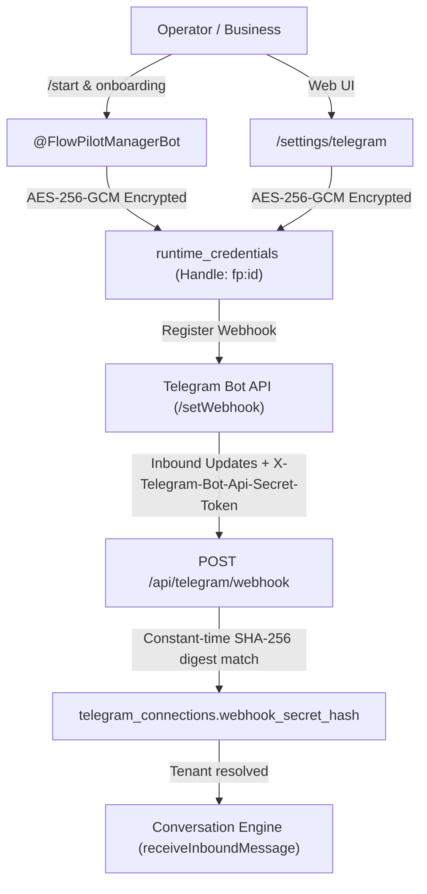

# FlowPilot — Post-Merge Telegram Acceptance Readiness & Operator Runbook

> **Authoritative Acceptance Readiness Record & Operator Runbook**  
> Covers baseline lineage verification, offline acceptance matrix results, concrete execution limit classifications, and the executable live acceptance plan for Telegram bot integration.

---

## 1. Baseline and Deployment Verification

| Check / Dimension               | Expected Fact / Standard                                 | Observed Reality                                                                              | Verification Source / Command                                            | Status           |
| :------------------------------ | :------------------------------------------------------- | :-------------------------------------------------------------------------------------------- | :----------------------------------------------------------------------- | :--------------- |
| **Merged Baseline PR**          | PR #29 (`feat/core-04b-global-ai-stop-execution-limits`) | PR #29 merged to `main` at `d291f1ac7cd22c7b8ac80cc05a6a39be97df53c4`                         | `git show origin/main -s`                                                | ✅ MATCH         |
| **Baseline Package Version**    | `0.70.0` (PR #29 baseline)                               | `0.70.0` (PR #29 baseline); incremented to `0.70.1` on feature branch for PR #30 quality gate | `git show origin/main:package.json`, `pnpm check:version`                | ✅ VERIFIED      |
| **Current origin/main SHA**     | `d291f1ac7cd22c7b8ac80cc05a6a39be97df53c4`               | `d291f1ac7cd22c7b8ac80cc05a6a39be97df53c4` (tag `v0.70.0`)                                    | `git rev-parse origin/main`                                              | ✅ UP-TO-DATE    |
| **Current Feature Branch HEAD** | PR #30 (`feat/telegram-acceptance-readiness`)            | Tracked on `origin/feat/telegram-acceptance-readiness`                                        | `git rev-parse HEAD`                                                     | ✅ CURRENT       |
| **Production Health URL**       | `https://flowpilot-prod.vercel.app/api/health`           | HTTP 200 OK                                                                                   | `curl -sS https://flowpilot-prod.vercel.app/api/health`                  | ✅ HEALTHY       |
| **Deployed Production SHA**     | `d291f1ac7cd22c7b8ac80cc05a6a39be97df53c4`               | `d291f1ac7cd22c7b8ac80cc05a6a39be97df53c4`                                                    | `/api/health` `commitSha`                                                | ✅ DEPLOYED_HEAD |
| **Deployed Production Version** | `0.70.0`                                                 | `0.70.0`                                                                                      | `/api/health` `version`                                                  | ✅ MATCH         |
| **Production DB State**         | `connected`, `deploymentReady: true`                     | `database: "connected"`, `deploymentReady: true`, `missingEnvVars: []`                        | `/api/health` response body                                              | ✅ CONNECTED     |
| **Production Health Timestamp** | Read-only observation                                    | `2026-10-23T18:37:11.639Z`                                                                    | Live response payload                                                    | ✅ RECORDED      |
| **Production CI Status**        | Post-deploy workflow passed                              | Success (Run `40000933519`)                                                                   | `gh run list --workflow "Production Release & Post-Deploy Verification"` | ✅ PASSED        |
| **Environment Isolation**       | Isolated staging/test environment                        | **PRODUCTION SHARED NEON POSTGRES** (`flowpilot-prod.vercel.app` is production; not isolated) | `docs/BUILD_STATE.md`, `/api/health` `environment: "production"`         | ⚠️ PROD_SHARED   |

> [!IMPORTANT]
> **Lineage Verdict: DEPLOYMENT_VERIFIED_CURRENT.**  
> The deployed production application at `flowpilot-prod.vercel.app` matches `origin/main` commit `d291f1a` (v0.70.0).  
> **However, `flowpilot-prod` is the LIVE production environment sharing the production Neon database and production credentials.** Live acceptance testing against production resources is strictly unauthorized and blocked until an isolated test environment is provisioned or operator authorization is granted under the live runbook below.

---

## 2. Acceptance Evidence Levels

All test cases and execution stages are classified strictly by the following four levels. Higher levels must **never** be inferred from lower levels:

- **Level A: Offline Controlled-Provider Execution.**  
  Injected mock/controlled AI adapters, in-memory state repository (`InMemoryConversationStateStore` with CAS revision tracking), in-memory appointments, deterministic availability, zero network wire calls, zero external provider spend.
- **Level B: Real-Provider Execution with Isolated In-Memory Repositories.**  
  Real LLM/JEV API HTTP calls via provider adapters under an authorized spend envelope, but strictly bounded to in-memory repositories and mock channel transports (zero database mutations, zero outbound messages).
- **Level C: Isolated Persistent-Database Integration.**  
  Dedicated, isolated staging/test PostgreSQL database running real Prisma repositories and migrations, separate from production data.
- **Level D: Actual Telegram Webhook-to-Reply Execution.**  
  End-to-end execution from incoming Telegram update through route proxy, webhook HMAC digest verification, Conversation Engine, Booking Core, database persistence, and outbound `sendMessage` to the Telegram Bot API.

---

## 3. Acceptance Matrix: 16 Journeys Verified Offline (Level A)

### Fixed Synthetic Business Configuration:

- **Business Name:** `عيادة النور لطب الأسنان`
- **Timezone:** `Africa/Cairo` (UTC+3 in late October under Egypt DST; UTC+2 standard time)
- **Reference Instant:** `2026-10-22T10:00:00.000Z` = **Thursday 13:00 (1:00 PM) Cairo time (UTC+3)**
- **Catalog Services:**
  1. `33333333-3333-4333-8333-333333333331`: "كشف أسنان" (30 min, 150 EGP)
  2. `33333333-3333-4333-8333-333333333332`: "تنظيف جير" (45 min, 300 EGP)
- **Providers:**
  1. `aaaaaaaa-aaaa-4aaa-8aaa-aaaaaaaaaaa1`: "د. أحمد سامي"
  2. `aaaaaaaa-aaaa-4aaa-8aaa-aaaaaaaaaaa2`: "د. علي محمود"
- **Working Hours:** Sat–Thu 09:00–18:00 (Cairo), Friday closed.

### Detailed Journey Results and Evidence Separation:

> [!NOTE]
> Physical wire calls are distinguished from mock adapter invocations. When direct mock responses are supplied, tests evaluate downstream engine behavior under supplied semantic facts without claiming real-language understanding accuracy. Missing provider telemetry is preserved truthfully as `null` rather than fabricated zeros.

| Journey ID | Name                                         | Test Nature / Description                                                                                     | Mock Invocations |      Physical Boundary Calls      | Engine ModelCallCount | Engine ProviderAttempts | Apts (Before → After) |          Offer Transition           | Result  |
| :--------: | :------------------------------------------- | :------------------------------------------------------------------------------------------------------------ | :--------------: | :-------------------------------: | :-------------------: | :---------------------: | :-------------------: | :---------------------------------: | :-----: |
|   **1**    | Telegram `/start`                            | Mechanical turn (zero model calls)                                                                            |        0         |                 0                 |           0           |            0            |         0 → 0         |          `NONE -> WELCOME`          | ✅ PASS |
|   **2**    | Natural-Language Booking Request             | Downstream engine behavior under supplied semantic facts                                                      |        1         |     `null` (not instrumented)     |           1           |      `null` (mock)      |         0 → 0         |       `NONE -> DATE(ACTIVE)`        | ✅ PASS |
|   **3**    | Provider Requested Before Service            | Downstream engine behavior under supplied semantic facts                                                      |        1         |     `null` (not instrumented)     |           1           |      `null` (mock)      |         0 → 0         |     `NONE -> SERVICE(CLARIFY)`      | ✅ PASS |
|   **4**    | Unknown or Ambiguous Provider                | Downstream engine behavior under supplied semantic facts                                                      |        1         |     `null` (not instrumented)     |           1           |      `null` (mock)      |         0 → 0         |       `NONE -> CLARIFICATION`       | ✅ PASS |
|   **5**    | Relative Date & Morning/Afternoon Preference | Downstream engine behavior; slots verified non-empty & Cairo morning (< 12:00)                                |        1         |     `null` (not instrumented)     |           1           |      `null` (mock)      |         0 → 0         |    `NONE -> SLOT(morning-only)`     | ✅ PASS |
|   **6**    | Date Correction After Offer                  | Downstream engine behavior; invalidates stale offer, preserves facts                                          |        2         |     `null` (not instrumented)     |           1           |      `null` (mock)      |         0 → 0         |         `OFFER -> REPLACED`         | ✅ PASS |
|   **7**    | Provider / Time-Preference Removal           | Downstream engine behavior; FactUpdate `REMOVE` cleans preference                                             |        2         |     `null` (not instrumented)     |           1           |      `null` (mock)      |         0 → 0         | `OFFER(morning) -> OFFER(all-day)`  | ✅ PASS |
|   **8**    | FAQ Interruption During Booking              | Downstream engine behavior; FAQ answered, active task & facts preserved                                       |        2         |     `null` (not instrumented)     |           1           |      `null` (mock)      |         0 → 0         |    `OFFER_SUSPENDED / PRESERVED`    | ✅ PASS |
|   **9**    | Valid Mechanical Selection                   | Mechanical turn (zero new model calls); creates appointment, consumes offer                                   |        0         |                 0                 |           0           |            0            |         0 → 1         |  `SLOT(ACTIVE) -> SLOT(CONSUMED)`   | ✅ PASS |
|   **10**   | Invalid Callbacks (5 subcases: 10a–10e)      | Mechanical turns; malformed, unknown action, expired (virtual clock), replaced, and cross-scope foreign token |        0         |                 0                 |           0           |            0            |         0 → 0         |      `NO_MUTATION / REJECTED`       | ✅ PASS |
|   **11**   | Duplicate Inbound & Repeated Tap             | Mechanical turns; same-externalId dedupe (11b) AND new-externalId repeated selection (11c)                    |        0         |                 0                 |           0           |            0            |    0 → 1 (stays 1)    |   `ACTIVE -> CONSUMED -> CLOSED`    | ✅ PASS |
|  **12a**   | Pre-AI `/start` CAS Conflict                 | Mechanical turn; state store CAS conflict intercepted; safe retry returned                                    |        0         |                 0                 |           0           |            0            |         0 → 0         |    `CAS_CONFLICT -> SAFE_RETRY`     | ✅ PASS |
|  **12b**   | Post-AI SLOT Offer CAS Conflict              | Instrumented physical wire dispatch; AI wire call dispatched before conflict                                  |        0         |          **1 wire call**          |           1           |            1            |         0 → 0         |  `SLOT_CAS_CONFLICT -> SAFE_RETRY`  | ✅ PASS |
|   **13**   | Staff-Owned Conversation Boundary            | Boundary enforcement; `DEFERRED_TO_STAFF`, zero model calls, zero outbound delivery                           |        0         |                 0                 |           0           |            0            |         0 → 0         |    `BLOCKED_BY_STAFF_OWNERSHIP`     | ✅ PASS |
|  **14a**   | Explicit Human Request Handoff               | Downstream engine behavior; intent `HUMAN_REQUEST` -> `CUSTOMER_REQUESTED_HUMAN`                              |        1         |     `null` (not instrumented)     |           1           |      `null` (mock)      |         0 → 0         | `HANDOFF(CUSTOMER_REQUESTED_HUMAN)` | ✅ PASS |
|  **14b**   | Sensitive Assessment Handoff                 | Downstream engine behavior; `safetyAssessment: "sensitive"` -> `SENSITIVE_OR_RESTRICTED`                      |        1         |     `null` (not instrumented)     |           1           |      `null` (mock)      |         0 → 0         | `HANDOFF(SENSITIVE_OR_RESTRICTED)`  | ✅ PASS |
|  **14c**   | Uncertain Assessment Handoff                 | Downstream engine behavior; `safetyAssessment: "uncertain"` fails safe to `SENSITIVE_OR_RESTRICTED`           |        1         |     `null` (not instrumented)     |           1           |      `null` (mock)      |         0 → 0         | `HANDOFF(SENSITIVE_OR_RESTRICTED)`  | ✅ PASS |
|   **15**   | Harmless Dialectal Utterance                 | Downstream engine behavior; semantic safety evaluates `safe`; no false handoff                                |        1         |     `null` (not instrumented)     |           1           |      `null` (mock)      |         0 → 0         |       `CONTINUED(AI_ACTIVE)`        | ✅ PASS |
|   **16**   | Global Stop, Attempt Limit & Deadline        | Injected controls (CORE-04B); truthful stop reasons; bounded physical dispatches                              |        0         | **1 wire call total** (0 + 1 + 0) |           1           |            1            |         0 → 0         | `CONTROLLED_STOP_SAFE_TERMINATION`  | ✅ PASS |

**Matrix Execution Summary:** 19/19 checks PASSED (0 FAILED) in `scripts/check-telegram-acceptance-matrix.ts` (`pnpm check:telegram-acceptance`).

---

## 4. Execution Limits: Implemented vs. Proposed Analysis

The table below provides a truthful classification of all proposed and implemented operational limits:

| Limit Dimension                            | Proposed Value         | Status in Codebase          | Scope of Enforcement          | Exact Enforcement Path & Mechanism                                                                                                                                                                                                                             | Verification Method                                                               |
| :----------------------------------------- | :--------------------- | :-------------------------- | :---------------------------- | :------------------------------------------------------------------------------------------------------------------------------------------------------------------------------------------------------------------------------------------------------------- | :-------------------------------------------------------------------------------- |
| **Per-Turn Serving Attempt Ceiling**       | Max 1–3 attempts       | **IMPLEMENTED**             | Single serving turn execution | `ServingExecutionSession` (`src/server/integrations/ai/execution-limits.ts`). Reads `FLOWPILOT_AI_MAX_SERVING_ATTEMPTS`, clamps to `[1, 3]`. Traps retries and secondary fallback. Note: shadow JEV runs asynchronously and is disjoint from serving attempts. | `pnpm check:core-04b`, `check-telegram-acceptance-matrix.ts` (Journey 16b)        |
| **Global AI Stop Switch**                  | Immediate halt         | **IMPLEMENTED**             | All AI executions             | Checked at entry of `ServingExecutionSession`. If `FLOWPILOT_AI_GLOBAL_STOP="1"`, `canDispatch()` returns `{ allowed: false, reason: "GLOBAL_STOP" }` before any wire call.                                                                                    | `pnpm check:core-04b`, `check-telegram-acceptance-matrix.ts` (Journey 16a)        |
| **Per-Turn Serving Deadline**              | Non-resetting deadline | **IMPLEMENTED**             | Single serving turn execution | `ServingExecutionSession` enforces monotonic start clock and `timeoutMs`. Shared across primary dispatch, internal retries, and secondary fallback.                                                                                                            | `pnpm check:core-04b`, `check-telegram-acceptance-matrix.ts` (Journey 16c)        |
| **Per-Request Output Tokens**              | 400 tokens             | **IMPLEMENTED**             | Single HTTP request           | `createOpenRouterAdapter` passes `max_tokens: 400` directly in the OpenRouter API payload.                                                                                                                                                                     | Inspected on outbound adapter wire payload                                        |
| **Campaign-Wide Physical Request Ceiling** | 20 physical calls      | **PROPOSED / HARNESS-ONLY** | Multi-turn campaign           | **Not implemented as a distributed serverless service.** CORE-04B bounds a single turn; there is no distributed cross-invocation call counter across Vercel serverless lambda executions.                                                                      | **BLOCKED for automated live execution.** Must be monitored manually by operator. |
| **Campaign Turn Ceiling**                  | 10 turns               | **PROPOSED / HARNESS-ONLY** | Conversation lifecycle        | **Not implemented in engine/database.** The conversation engine does not terminate conversations after N turns.                                                                                                                                                | Manual operator stop                                                              |
| **Hard Dollar Spend Cap**                  | $0.05 USD              | **PROPOSED ESTIMATE ONLY**  | Campaign planning             | **Not enforceable via OpenRouter API.** OpenRouter does not support real-time programmatic monetary budget termination. Dollar figures are planning estimates based on DeepSeek-V3 pricing ($0.2574/M input, $1.0287/M output).                                | Operator dashboard post-run inspection                                            |

---

## 5. Live Acceptance Operator Runbook (Managed Bot Architecture)

> [!CAUTION]
> **LIVE EXECUTION STATUS: BLOCKED.**  
> Live acceptance against `flowpilot-prod.vercel.app` is blocked because it shares production Neon PostgreSQL data and production credentials. Live execution requires an isolated staging database and a dedicated test bot.

### 5.1 Real Codebase Telegram Configuration (Managed Bot Architecture)

FlowPilot does **NOT** configure business bots via global `.env` tokens (`TELEGRAM_BOT_TOKEN`). Instead, it uses the **Managed Bot Architecture**:



1. **Test Business Provisioning:**
   Ensure the isolated operator test business exists in the database:

   ```bash
   pnpm bootstrap:test-business
   ```

   _Test Business ID:_ `f47ac10b-58cc-4372-a567-0e02b2c3d479` (`مركز الاختبارات التجريبي`).

2. **Dedicated Test Bot Provisioning:**
   - Create a dedicated test bot via `@BotFather` (e.g. `@FlowPilotAcceptanceTestBot`).
   - Navigate to `/settings/telegram` or initiate onboarding through `@FlowPilotManagerBot`.
   - The bot token is encrypted using AES-256-GCM and stored **only** as an opaque `fp:<id>` runtime reference in `runtime_credentials` (never stored in plain text, logs, or client-side payloads).
   - The webhook is set to `https://<isolated-test-domain>/api/telegram/webhook` with a cryptographically random secret token.
   - The SHA-256 digest of the secret is stored in `telegram_connections.webhook_secret_hash`.

3. **Inbound Webhook Verification:**
   On inbound update, `POST /api/telegram/webhook` reads the `X-Telegram-Bot-Api-Secret-Token` header, computes its SHA-256 digest, and performs a constant-time comparison against `telegram_connections.webhook_secret_hash` to resolve the test business tenant. An invalid or foreign token returns HTTP 401 immediately.

### 5.2 Manual Mobile Telegram Acceptance Script (When Authorized on Isolated Environment)

When an isolated test environment is provisioned and authorized:

1. **Step 1: Send `/start`**
   - _Action:_ Send `/start` to the dedicated test bot.
   - _Expected:_ Welcome greeting with business name, free-text guidance, and inline buttons («حجز موعد», «استفسار عن خدمة»). Zero model calls consumed.
2. **Step 2: Tap «حجز موعد»**
   - _Action:_ Tap the inline button.
   - _Expected:_ Service catalog options presented with zero generative model calls.
3. **Step 3: Natural Text Booking Request**
   - _Action:_ Type «عايز كشف أسنان السبت الصبح».
   - _Expected:_ Slots filtered for Saturday morning (< 12:00 Cairo time) presented as interactive buttons.
4. **Step 4: Date/Time Correction**
   - _Action:_ Type «لا خليه يوم الأحد بعد الظهر أفضل».
   - _Expected:_ Previous slot offer invalidated; new afternoon slots for Sunday presented.
5. **Step 5: Slot Selection Confirmation**
   - _Action:_ Tap an available slot button.
   - _Expected:_ Booking confirmed message with date/time details; exactly 1 appointment created in database; offer marked `CONSUMED`.
6. **Step 6: Repeated Button Tap (Double-Tap Test)**
   - _Action:_ Tap the already-consumed slot button again.
   - _Expected:_ Safe notice that the offer is no longer available / already consumed; zero duplicate appointment created.

---

## 6. Blocker and Risk Register

|     Severity     | Item                                             | Impact                                                                                                                                | Status & Remediation                                                                                    |
| :--------------: | :----------------------------------------------- | :------------------------------------------------------------------------------------------------------------------------------------ | :------------------------------------------------------------------------------------------------------ |
| **P1 (Blocker)** | **Production Environment Shared Target**         | `flowpilot-prod.vercel.app` is production; running live tests directly against it risks customer data mutation and channel crosstalk. | **BLOCKED for direct live execution on production.** Operator must provision isolated test environment. |
| **P2 (Blocker)** | **Campaign-Wide Execution Limits Unimplemented** | Multi-turn 20-call campaign ceilings and dollar caps are proposed/harness-only, not implemented as a distributed serverless service.  | **BLOCKED for automated live execution.** Live trial requires manual operator monitoring.               |
| **P3 (Caution)** | **Lack of Provider-Side Monetary Cap**           | OpenRouter lacks API-driven balance cutoff; runaway loops could consume funds if unmonitored.                                         | Guarded per-turn by CORE-04B attempt limits (max 3) and 12s non-resetting deadline.                     |

---

## 7. Recommendation and Verdict

### Final Authoritative Verdict:

`ACCEPTANCE_MATRIX_OFFLINE_VERIFIED_LEVEL_A__LIVE_STAGE_BLOCKED`

**Evaluation Summary:**

1. **Lineage Baseline Verified:** PR #29 merged commit `d291f1ac7cd22c7b8ac80cc05a6a39be97df53c4` (v0.70.0) is verified both in repository git history and on the live production `/api/health` deployment endpoint.
2. **Offline Acceptance Matrix (Level A) 100% Passed:** 19/19 checks passed in `scripts/check-telegram-acceptance-matrix.ts` (`pnpm check:telegram-acceptance`).
3. **Evidence Integrity Repaired:** Removed all fabricated physical attempt counts. Distinguished mock invocations, physical boundary calls (1 wire call in 12b, 0 wire calls in 12a/10/11), logical modelCallCount, and engine `providerAttempts` (retaining `null` when telemetry is absent).
4. **Missing Coverage Completed:** Completed Journey 10 (5 distinct subcases with verified revision saves and virtual clock), Journey 11 (same-externalId dedupe AND repeated tap with new externalId), Journey 12 (pre-AI CAS conflict 12a AND post-AI wire-dispatched slot conflict 12b), and Journey 14 (explicit human 14a, sensitive 14b, and uncertain 14c).
5. **Timezone Assertions Corrected:** Documented `2026-10-22T10:00:00Z` as 13:00 (1:00 PM) in `Africa/Cairo` (UTC+3 Egypt DST). Verified slot lists are non-empty before checking morning filtering in Cairo timezone.
6. **Limits & Runbook Truthfulness:** Correctly classified implemented vs proposed limits (CORE-04B is strictly per-turn, not campaign-wide). Described actual Managed Bot architecture (`@FlowPilotManagerBot`, `/settings/telegram`, `fp:<id>` in `runtime_credentials`, SHA-256 digest in `telegram_connections`).
7. **Live Stage Status:** Formally marked **BLOCKED** pending isolated staging resources and operator authorization.
